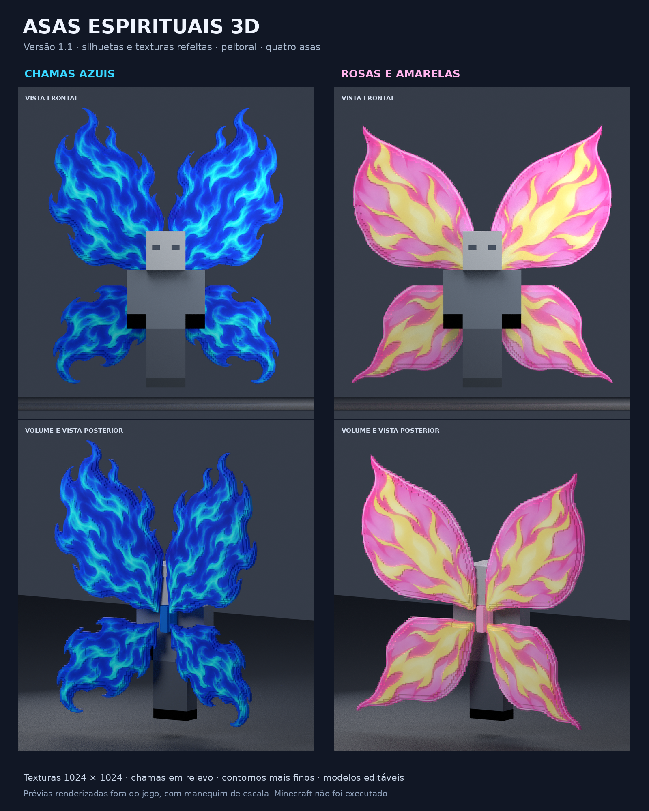

# Modelos — Forge Studio

Modelos editáveis e addons para Minecraft Bedrock.

## Clã Hōzuki — revisão visual 18.11.76

- [Comparação com o anime, três modelos animados e opções de instalação](Hozuki/)
- [Pacote com addon e integração](https://github.com/Forge-Studio0/models/raw/refs/heads/main/Hozuki/Hozuki.zip)

## Clã Kaguya — modelos aprovados 18.11.73

- [Cinco modelos do Blockbench e opções de instalação](Kaguya/)
- [Pacote final com addon e integração](https://github.com/Forge-Studio0/models/raw/refs/heads/main/Kaguya/Kaguya.zip)
- [Addon para importar no Minecraft](https://github.com/Forge-Studio0/models/raw/refs/heads/main/Kaguya/Kaguya.mcaddon)

## Clã Aburame — modelos aprovados 18.11.72

- [Seis modelos atuais do Blockbench](Aburame/Modelos_Blockbench)
- [Pacote completo com addon e integração](https://github.com/Forge-Studio0/models/raw/refs/heads/main/Aburame/Aburame.zip)
- [Addon para importar no Minecraft](https://github.com/Forge-Studio0/models/raw/refs/heads/main/Aburame/Aburame.mcaddon)

## Clã Iburi — modelos atuais 18.11.68

A pasta do clã contém somente os três modelos atuais, com texturas e animações embutidas, editáveis no Blockbench. O funcionamento do modo foi confirmado pelo usuário.

- [Modelos atuais do clã Iburi](Iburi/Modelos_Blockbench)

## Asas 3D — versão 1.1.0

Dois conjuntos com quatro asas, equipáveis no peitoral: **Chamas Azuis** e **Asas Espirituais Rosas**. A versão 1.1 refaz as silhuetas, as asas inferiores, o acabamento do volume e as texturas em 1024 × 1024.

- [Baixar a addon .mcaddon](https://github.com/Forge-Studio0/models/raw/refs/heads/main/Asas_3D_Bedrock/Asas_3D_Teste_Bedrock.mcaddon)
- [Modelos editáveis no Blockbench](Asas_3D_Bedrock/Modelos_Blockbench)
- [Instruções de instalação e edição](Asas_3D_Bedrock/LEIA-ME.md)
- [Alterações da versão 1.1](Asas_3D_Bedrock/ALTERACOES.md)

Os renders são prévias externas com manequim de escala. A validação inclui os arquivos dos packs e a abertura/exportação no Blockbench; não houve teste dentro do Minecraft.
